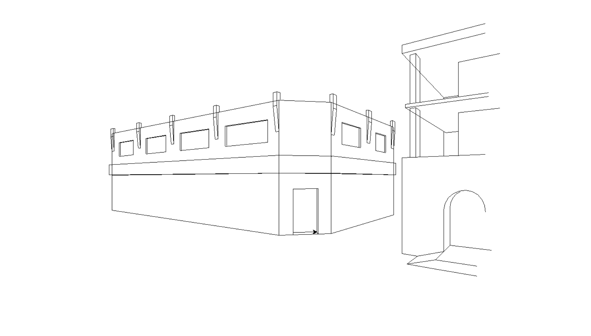

# Description
## Main
This program draws some simple street side buildings in perspective using the `turtle` graphics library.

The program demonstrates basic concepts in Python, including:

* Using functions to modularize code
* Simple vector math
* Simple geometric transformations

## Alternate
This program allows you to draw anything and save it into a separate python file using the `turtle` graphics library. 

The program demonstrates basic concepts in Python, including:

* Using functions to modularize code
* Input reading
* Writing to other files

# Code Overview
## Main
The project is structured around reusable functions:
* `toPoint(dist, dir, start, up, slope,  interStart, interEnd)` - draws a line towards a point, with added ability to stop when intersecting a line between two points
* `line(start, end, up, interStart, interEnd)` - draws a line between points with added ability to stop when intersecting a line between two points
* `scale(pos, point, side)` - returns a scale value according to the distance from a vanishing point

## Alternate
The project is structured around input functions:
* `s.onscreenclick(movement, 3)` - moves the turtle to mouse position on right click
* `t.ondrag(while_drag)` - draws line while left click held down
* `s.onkeypress(colour, "c") & s.onkeypress(size, "g")` - changes colour and size respectively

## How to Run

1. Clone or download this repository.
2. Open the project file `COMP_115_turtle_project.py` or `alternate_turtle_project.py` in your Python IDE or text editor.
3. Run the program:
### Only if running alternate program:
* Right click to teleport the pen to your mouse position
* Left click and drag the pen to draw
* Press C to open the colour change input box (input the colours name)
* Press G to open the size change input box (input an integer)
* Close the window to save it in file `destination.py`
